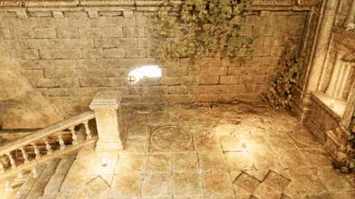

# World Voxel Paint

An Unreal Engine plugin for painting voxel data directly onto surfaces in a level and sampling it in materials.

Jack Minnetian used an experimental planning tool we built at Sourcebot to work through a 3,000-line design with AI. He handed the finished plan to Claude, which built a working version of the plugin in one shot over 14 hours. [Read how Jack planned and built it](https://www.sourcebot.dev/blog/one-shotting-an-unreal-engine-plugin).

## Demo

[Watch the 7-second demo](https://static.sourcebot.dev/website/blog/media/one-shotting-an-unreal-engine-feature/voxel-paint-hero-web-v4.mp4)

## Install

Use Unreal Engine 5.7 and a C++ build toolchain.

1. Clone or download this repo into your project's `Plugins/WorldVoxelPaint/` folder. The `WorldVoxelPaint.uplugin` file should be directly inside that folder.
2. Open your project, enable **World Voxel Paint** and **PCG** under **Edit > Plugins**, then restart the editor.
3. Rebuild the modules if Unreal prompts you. You can also build your project's Editor target from your IDE.
